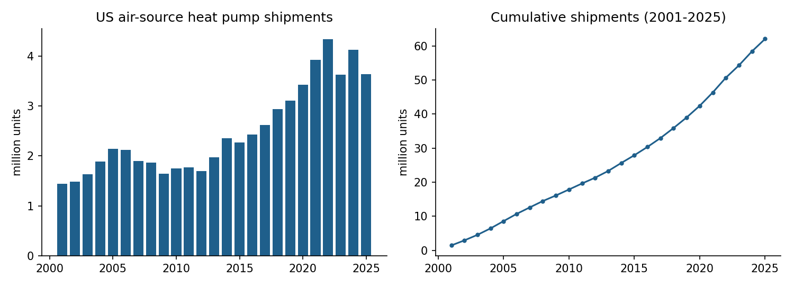
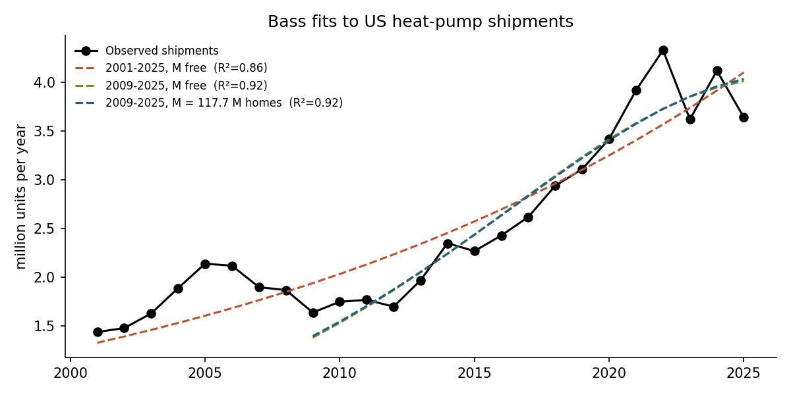
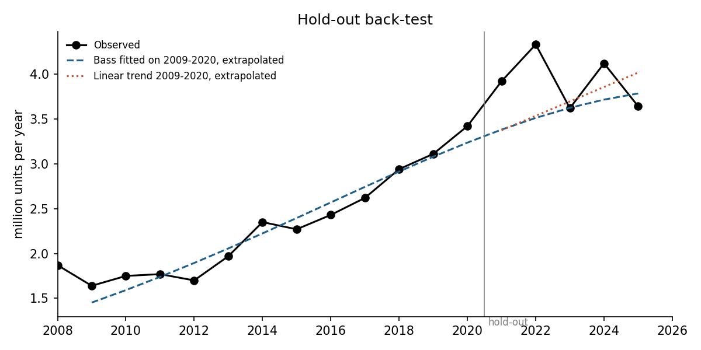
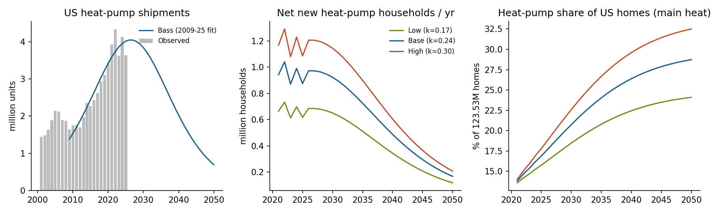
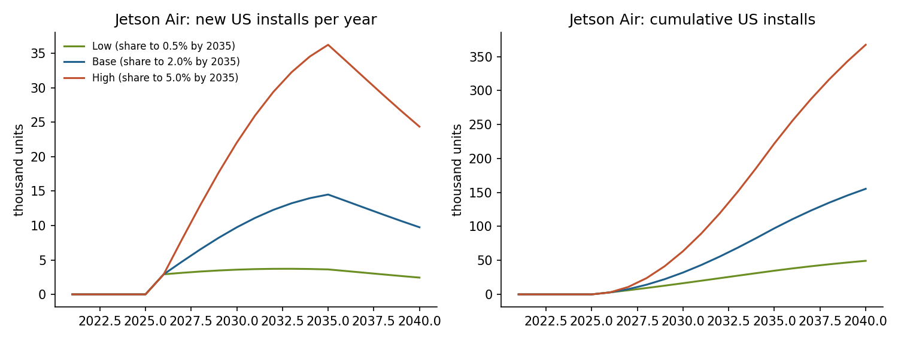

# 1. Selected innovation

**Jetson Air** (Jetson Home, Vancouver) is a smart, central heat-pump system that heats and cools a whole home through existing ductwork, with built-in software for energy optimisation, air-quality sensing and system-health monitoring. It launched in September 2025 and was named to **TIME's Best Inventions of 2025** list (TIME, 2025; Techcouver, 2025). TIME highlighted its attack on the main barrier to heat-pump adoption, installation cost, through remote project assessment and one-day installs. By January 2026 Jetson reported more than 1,000 installed systems, operations in Colorado, Massachusetts and New York plus Vancouver, and a US$50M Series A to expand across the US (Business Wire, 2026).

*TIME entry for Jetson Air:* <https://time.com/collections/best-inventions-2025/7318347/jetson-air/>. *Jetson press release:* <https://jetsonhome.com/ca/press/press-release>.

# 2. Look-alike innovation and justification

**Look-alike: the US air-source heat pump (ASHP) as a product category.** A first candidate was central air conditioners, but they only cool. Jetson Air is a reversible heat pump that replaces a furnace *and* an air conditioner, so ASHPs are the technologically closest historical analogue: same refrigerant-cycle hardware, same ducted installation, same purchase decision (a replacement of central HVAC equipment), same buyers (US homeowners), and same manufacturer channel (contractors and distributors).

Jetson Air differs from a generic ASHP in the *service model* (online pricing, one-day install, monitoring app, subscription warranty). Historical heat-pump diffusion is therefore a benchmark for the **underlying technology's adoption speed (p, q)**, not a forecast of Jetson's market share. The forecast therefore has two layers: (i) how fast US households move to heat pumps as a category, using the look-alike, and (ii) what share of that flow Jetson captures, which is an explicit assumption because no history exists.

# 3. Historical data

Annual **US shipments of air-source heat pumps, 2001-2025** (million units), from Statista, which republishes the US manufacturers' shipment statistics of the **Air-Conditioning, Heating, and Refrigeration Institute (AHRI)** (Statista, 2026; AHRI, 2026). File: `data/us_air_source_heat_pump_shipments_2001_2025.csv`. Shipments rose from 1.44M (2001) to a peak of 4.33M (2022), with dips in 2007-09 (housing bust), 2023 and 2025.

*Data check.* The series was spot-checked against AHRI's published shipment releases: 2022 = 4,334,479 units (series: 4.33M) and 2021 = 3,916,766 (series: 3.92M) (AHRI via Refrigeration Industry, 2023). Both match.

**Important definition issue.** Shipments are units sold into the US market by manufacturers. They include (a) replacements of old heat pumps, (b) heat pumps bought mainly for cooling, and (c) new adopters. Over 2001-2025 shipments total 62.1M units, yet EIA's household survey finds only 16.13M US homes with a central heat pump as main heating equipment in 2020 (EIA, 2023a). Shipments are therefore **not** a count of adopters. Section 5 corrects for this.

# 4. Estimating Bass parameters on the look-alike

**Model.** Following the lecture (Hovhannisyan, 2026), F(t) = (1 - e^(-(p+q)t)) / (1 + (q/p) e^(-(p+q)t)), and sales in period i are S_i = M [F(i) - F(i-1)], with t = 0 at 1 January of the first year. I minimise squared error on annual shipments with nonlinear least squares (the lecture's `nls` approach; the R `diffusion` package is not used, but the objective is the same), positive p and q, from 20 multi-start values. Code: `analysis.py`. The lecture's peak-time formula t* = ln(q/p)/(p+q) is used for diagnostics.

**Result 1: the full 2001-2025 series cannot identify a market potential.** With M free, the optimiser pushes M to my upper bound of 5,000M units, with p = 0.0003, q = 0.0477: the series shows steady growth with no saturation, and the Bass curve is nearly exponential. Fixing M to a Fermi value gives poor fits (R^2 about 0.72-0.74).

**Result 2: the post-2008 window fits well.** Starting at 2009, the trough after the housing bust, shipments follow a clear rise-and-plateau pattern. I treat 2009 as the start of a new diffusion wave (post-bust recovery, then efficiency programmes and rising electrification interest). **This window is an analyst choice, and I show the sensitivity to it.**

| Specification | p | q | M (M units) | R^2 | RMSE | Implied peak year |
|---|---|---|---|---|---|---|
| 2001-2025 | M free | 0.0003 | 0.0477 | 5,000 (bound) | 0.856 | 0.33 | n/a |
| 2009-2025 | M free | 0.0115 | 0.1183 | 113.7 | 0.924 | 0.24 | 2026 |
| 2001-2025 | M = 117.74 | 0.0077 | 0.1021 | 117.7 | 0.720 | 0.46 | 2024 |
| 2009-2025 | M = 117.74 | 0.0113 | 0.1154 | 117.7 | 0.924 | 0.24 | 2026 |
| 2001-2025 | M = 123.53 | 0.0076 | 0.0983 | 123.5 | 0.737 | 0.45 | 2024 |
| 2009-2025 | M = 123.53 | 0.0109 | 0.1117 | 123.5 | 0.923 | 0.24 | 2027 |
| 2009-2025 | M = 61.77 | 0.0122 | 0.2124 | 61.8 | 0.728 | 0.46 | 2021 |

**Chosen look-alike parameters (2009-2025, M free):** **p = 0.0115, q = 0.1183, M = 113.7 million units** (R^2 = 0.924). Leave-one-year-out re-estimates give p in [0.0108, 0.0115] and q in [0.111, 0.120] (with M fixed at 117.7M), so p and q are stable within this window. The model's own peak falls in 2026, a few years after the observed peak year (2022). The lecture runs the same check for smartphones (predicted 11.5 vs actual 12).

*Interpretation.* q is about 10 times p, so imitation (word of mouth, contractor and neighbour recommendations, visible installs) dominates innovation (advertising and policy) in this look-alike, as in most durable-goods diffusions in Bass (1969). M is expressed in *shipment units*, and it is not a count of households.

**Hold-out back-test.** Fitting only 2009-2020 (M fixed at 117.7M, R^2 = 0.95) and extrapolating to 2021-2025 gives a mean absolute percentage error of **9.3%** (RMSE 0.48M units), versus 10.2% for a simple linear trend. The Bass curve therefore does no worse than a naive trend out of sample, but it also does not clearly beat it, and it cannot anticipate year-to-year shocks (2023 and 2025 dips).

| Year | Actual (M) | Bass fitted on 2009-20 | Linear trend |
|---|---|---|---|
| 2021 | 3.92 | 3.38 | 3.37 |
| 2022 | 4.33 | 3.51 | 3.53 |
| 2023 | 3.62 | 3.62 | 3.70 |
| 2024 | 4.12 | 3.72 | 3.86 |
| 2025 | 3.64 | 3.78 | 4.02 |

# 5. From shipments to adopters: transferring the diffusion to Jetson's market

## 5.1 Scope: United States

I analyse the **United States** because (i) the look-alike data (AHRI), the household benchmarks (EIA RECS) and Jetson's current growth plans are all US-specific or US-led (Business Wire, 2026), (ii) Jetson's New York rebates of US$5,000-8,000 and its expansion states make the US the relevant demand environment (Jetson Home, 2026), and (iii) mixing in Canada or the EU would combine different climates, prices and policy regimes with no matching historical series. The cost is that results do not describe Jetson's Canadian sales.

## 5.2 Replacement adjustment (the Fermi step)

Because Jetson sells to households that switch to a heat pump, the quantity to forecast is **net new heat-pump households**, not shipments. I link the two with a conversion ratio k = net new heat-pump main-heating homes / shipments over the same period, using the EIA's Residential Energy Consumption Survey (RECS) stock of homes with a heat pump as main heating equipment: about 9.8M in 2009 (CLASP, 2025, summarising RECS), 11.8M in 2015 (EIA, 2017) and 16.13M in 2020 (EIA, 2023a).

| Period | Net new HP homes (M) | AHRI shipments in period (M) | k = net / shipments |
|---|---|---|---|
| 2009-2015 | 2.00 | 11.81 | 0.17 |
| 2015-2020 | 4.33 | 14.52 | 0.30 |
| 2009-2020 | 6.33 | 26.33 | 0.24 |

Only about 24% of shipments (range 17-30%) translated into net new heat-pump main-heating homes. The rest were replacements, cooling-first purchases or units for secondary uses. k rose between the two periods, consistent with a diffusion process gathering speed. I use **k = 0.24 (base), 0.17 (low), 0.30 (high)** and assume k stays constant, which is a strong assumption.

*Caveat on the stock series:* the 2015 and 2020 RECS counts are comparable in intent, but survey design and equipment definitions changed between cycles, and the 2009 value is taken from a secondary summary. EIA also reports 1.06M ductless (mini-split) main-heating homes in 2020 (EIA, 2023a), which I exclude because Jetson Air is a ducted central system. As a cross-check, Davis (2023) reports that about 14% of US households (17.2M) use a heat pump as primary heating in the same 2020 survey, consistent with 16.13M central plus 1.06M ductless.

## 5.3 Market potential: two independent views

* **Fermi ceiling.** RECS counts 123.53M US homes, of which 117.74M use space-heating equipment (EIA, 2023a, 2023b). If every such home eventually switched, M would be 117.7M. This is a ceiling, not a forecast.
* **Look-alike implied potential.** The shipment M of 113.7M units times k gives an adopter potential of 27.3M additional homes (range 19.2-33.9M), which is a total heat-pump stock of about 37M homes (30% of all US homes; range 24-35%).

The look-alike-implied potential is well below the Fermi ceiling. A plausible reading is that heat pumps are concentrated in warmer regions (in 2020, 12.52M of the 16.13M heat-pump homes were in the South census region; EIA, 2023a), while cold climates, homes without ducts and fuel-switching costs hold back the rest. The forecast uses the look-alike-implied view, and the ceiling is shown only as an upper bound. A forecast that forced the household count to the 117.7M ceiling would imply roughly 3-4M net new heat-pump homes a year, several times the 0.87M a year observed between 2015 and 2020, so I rejected it.

## 5.4 Category forecast: net new US heat-pump households

Shipments are taken as observed through 2025 and as the fitted Bass curve (p = 0.0115, q = 0.1183, M = 113.7) from 2026. Net new households = k x shipments. The Bass curve implies shipments of 4.04M in 2026, falling to 3.02M in 2035 and 2.03M in 2040 (after a 2026 peak). The decline reflects the fitted Bass saturation and **not** a forecast that replacement demand disappears. Since k applies only to the diffusion wave, I do not use the curve to forecast total shipments in the long run.

| Year | Low (M) | Base (M) | High (M) | Base HP-household stock (M) | Share of US homes |
|---|---|---|---|---|---|
| 2026 | 0.68 | 0.97 | 1.21 | 21.8 | 17.7% |
| 2027 | 0.68 | 0.97 | 1.21 | 22.8 | 18.5% |
| 2028 | 0.68 | 0.96 | 1.19 | 23.8 | 19.2% |
| 2030 | 0.65 | 0.92 | 1.14 | 25.6 | 20.7% |
| 2032 | 0.60 | 0.86 | 1.06 | 27.4 | 22.2% |
| 2035 | 0.51 | 0.73 | 0.90 | 29.7 | 24.0% |
| 2040 | 0.34 | 0.49 | 0.60 | 32.6 | 26.4% |
| 2045 | 0.21 | 0.29 | 0.37 | 34.4 | 27.9% |
| 2050 | 0.12 | 0.17 | 0.21 | 35.5 | 28.7% |

By 2035 the base-case stock is 29.7M homes (24% of US homes), up from 16.1M (13.1%) in 2020. By 2050 it is 35.5M (29%).

# 6. Adopters of Jetson Air by period

## 6.1 Jetson's share, an explicit assumption

No history exists for a product launched in September 2025, so Jetson's share of net new heat-pump households is a scenario assumption, anchored on its only observed data point: "more than 1,000" systems in roughly 4.5 months (Business Wire, 2026), i.e. about 2,667 installs a year across the US and Vancouver. Against 972,238 base-case US net new heat-pump homes in 2026, this is **about 0.27% of the flow**, so I start every scenario at 0.30% in 2026. (The 1,000 figure includes Canada, and the start period was a launch ramp.) The share then rises linearly to a 2035 level and stays flat:

* **Low:** 0.5% by 2035. Jetson stays a niche premium brand.
* **Base:** 2% by 2035. It becomes a recognised challenger with a stable regional footprint.
* **High:** 5% by 2035. It scales like a disruptive entrant and wins one in twenty heat-pump switchers.

These shares are my assumptions and are **not estimated from data**. The point of the exercise is to show the size of the market implied by the diffusion model and what Jetson would need to capture in it.

## 6.2 Results (base category forecast)

| Year | Base share of net new HP homes | New installs: Low | New installs: Base | New installs: High | Cumulative installs: Base |
|---|---|---|---|---|---|
| 2026 | 0.30% | 2,917 | 2,917 | 2,917 | 2,917 |
| 2027 | 0.49% | 3,131 | 4,751 | 7,990 | 7,667 |
| 2028 | 0.68% | 3,317 | 6,527 | 12,948 | 14,195 |
| 2029 | 0.87% | 3,471 | 8,203 | 17,669 | 22,398 |
| 2030 | 1.06% | 3,588 | 9,740 | 22,043 | 32,138 |
| 2031 | 1.24% | 3,669 | 11,105 | 25,979 | 43,243 |
| 2032 | 1.43% | 3,711 | 12,275 | 29,403 | 55,518 |
| 2033 | 1.62% | 3,716 | 13,234 | 32,270 | 68,753 |
| 2034 | 1.81% | 3,687 | 13,976 | 34,554 | 82,729 |
| 2035 | 2.00% | 3,625 | 14,501 | 36,253 | 97,230 |
| 2040 | 2.00% | 2,437 | 9,747 | 24,367 | 155,349 |
| 2045 | 2.00% | 1,472 | 5,890 | 14,725 | 191,993 |
| 2050 | 2.00% | 834 | 3,335 | 8,338 | 213,289 |

Under the base case Jetson installs about 9,740 systems in 2030 and 14,501 in 2035, with **97,230 cumulative US installs by the end of 2035** (low 34,832, high 222,024). By 2050 the base case is 213,289. Annual installs peak around 2035 and then fall, because the category's net adoption flow is shrinking while the share is held flat.

**Sensitivity: cumulative Jetson installs by end-2035 (thousand units).**

| Category scenario | Share: Low | Share: Base | Share: High |
|---|---|---|---|
| Low category (k=0.17) | 25 | 68 | 156 |
| Base category (k=0.24) | 35 | 97 | 222 |
| High category (k=0.30) | 43 | 121 | 275 |

The share assumption moves the result about **6-fold** (low to high), while the category assumption (k) moves it only about **1.8-fold**. Jetson's own execution, rather than the diffusion curve, is the main uncertainty.

# 7. Limitations and what I would do next

1. **Shipments are not adoptions.** The replacement adjustment (k) rests on three RECS points, one from a secondary source, and k is assumed constant. This is the weakest link.
2. **Window choice.** The 2009-2025 window gives a well-behaved Bass fit, whereas 2001-2025 does not. The choice is justified by the housing-bust break but remains judgemental.
3. **Bass assumes a fixed market, no price or policy effects.** Heat-pump demand is clearly driven by incentives (US tax credits, state rebates), prices and fuel costs, none of which the basic Bass model includes. A generalised Bass model with price or policy variables would be a natural extension.
4. **Jetson is a service-model entrant into a mature category.** Its share path is an assumption. The 1,000-install anchor includes Canada and a launch period.
5. **Ductwork and climate.** Jetson Air needs existing ducts, and the household addressable market is smaller than "all homes". The Fermi ceiling and scenarios are therefore generous.
6. **Data scope.** The series covers US manufacturers' shipments as reported by AHRI. It was spot-checked for 2021 and 2022, and its treatment of ductless units may differ from the RECS household categories used in Section 5.2.
7. **Short, noisy series.** 17 annual observations and 3 parameters give limited precision. The reported leave-one-out ranges are sensitivity checks, not confidence intervals.

# References

AHRI. (2026). *Central air conditioners and air-source heat pumps: historical shipment data.* Air-Conditioning, Heating, and Refrigeration Institute. <https://www.ahrinet.org/analytics/statistics/historical-data/central-air-conditioners-and-air-source-heat-pumps>

AHRI via Refrigeration Industry. (2023). *AHRI releases December 2022 U.S. heating and cooling equipment shipment data* (year-to-date heat-pump shipments 4,334,479 in 2022; 3,916,766 in 2021). <https://refindustry.com/?p=36865>

Bass, F. M. (1969). A new product growth for model consumer durables. *Management Science, 15*(5), 215-227.

Business Wire. (2026, January 20). *Jetson raises $50M Series A to expand home electrification across new U.S. markets.* <https://www.businesswire.com/news/home/20260120338023/en/Jetson-Raises-%2450M-Series-A-to-Expand-Home-Electrification-Across-New-U.S.-Markets>

CLASP. (2025). *Technical appendix - space heating* (US heat-pump stock by RECS year, 1993-2015). <https://www.clasp.ngo/wp-content/uploads/2025/01/Technical-Appendix-Space-Heating.pdf>

Davis, L. W. (2023). *The economic determinants of heat pump adoption* (NBER Working Paper 31344). <https://www.nber.org/system/files/working_papers/w31344/w31344.pdf> (cross-check: about 14% of US households, 17.2M, have a heat pump as primary heating).

EIA. (2017). *2015 Residential Energy Consumption Survey, Table HC6.5: Space heating in U.S. homes by household income* (heat pump main heating: 11.8M of 118.2M homes). <https://eia.gov/consumption/residential/data/2015/hc/php/hc6.5.php>

EIA. (2023a). *2020 Residential Energy Consumption Survey, Table HC6.8: Space heating in homes in the South and West regions* (and national totals: 123.53M homes, 117.74M using heating equipment, 16.13M central heat pump, 1.06M ductless). <https://www.eia.gov/consumption/residential/data/2020/hc/pdf/HC%206.8.pdf>

EIA. (2023b). *2020 Residential Energy Consumption Survey, Table HC10.9* (5.79M homes without heating equipment). <https://www.eia.gov/consumption/residential/data/2020/hc/pdf/HC%2010.9.pdf>

Hovhannisyan, K. (2026). *Bass model for innovation diffusion* [Lecture slides, DS 223 Marketing Analytics]. American University of Armenia.

Jetson Home. (2026). *Press: Jetson Air and New York rebates.* <https://jetsonhome.com/us/press>

Statista. (2026). *Air-source heat pump shipments in the US since 2001.* <https://www.statista.com/statistics/220358/air-source-heat-pump-shipments-in-the-us-since-2001/> (data file: `data/us_air_source_heat_pump_shipments_2001_2025.csv`).

Techcouver. (2025, October 9). *Jetson named to TIME's list of Best Inventions of 2025.* <https://techcouver.com/2025/10/09/jetson-named-to-times-list-of-best-inventions-of-2025/>

TIME. (2025, October 9). *The Best Inventions of 2025.* <https://time.com/collections/best-inventions-2025/>
